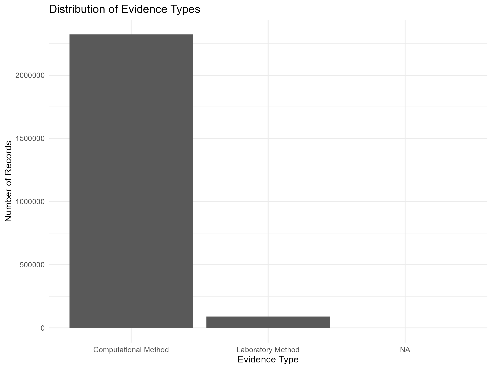
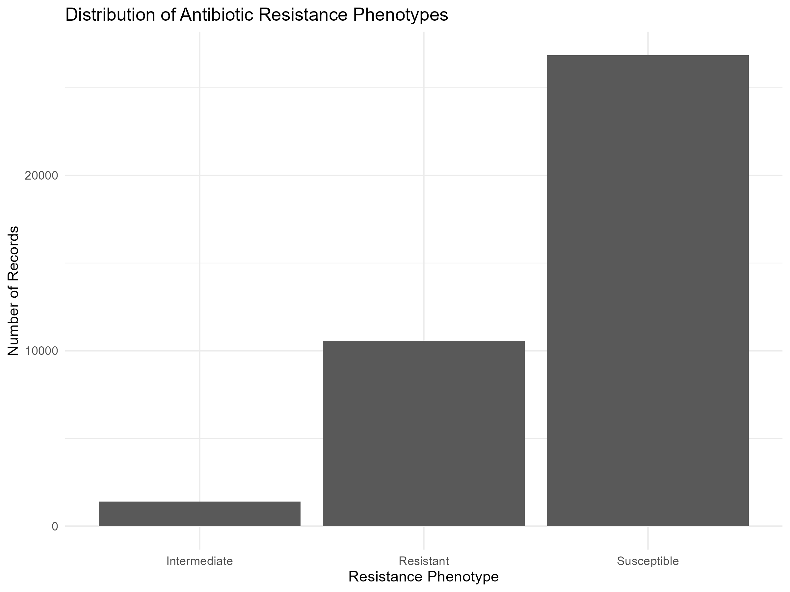
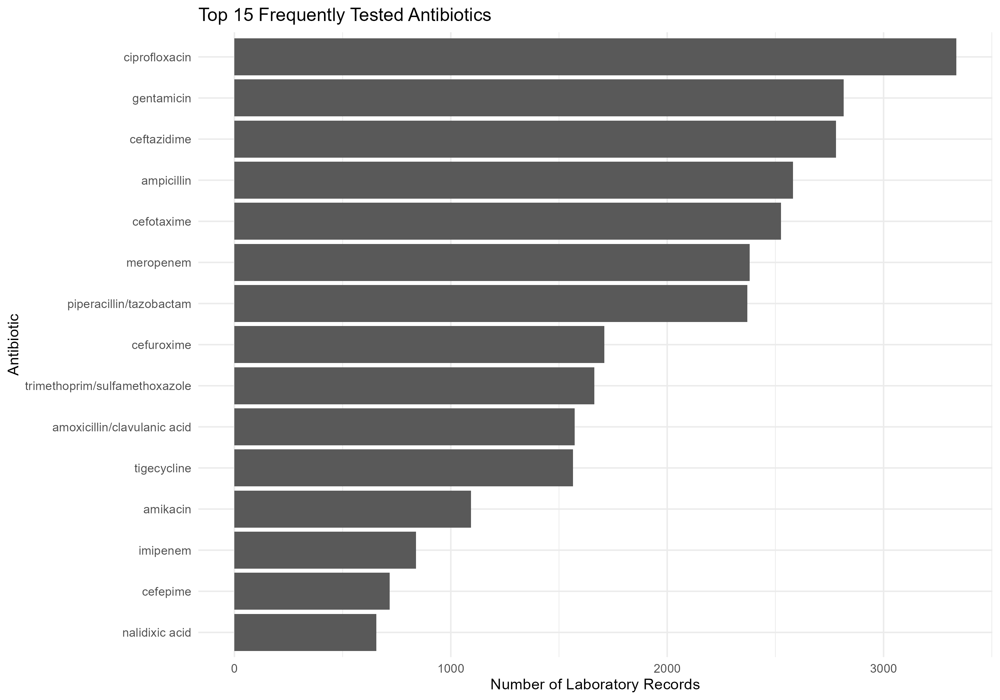
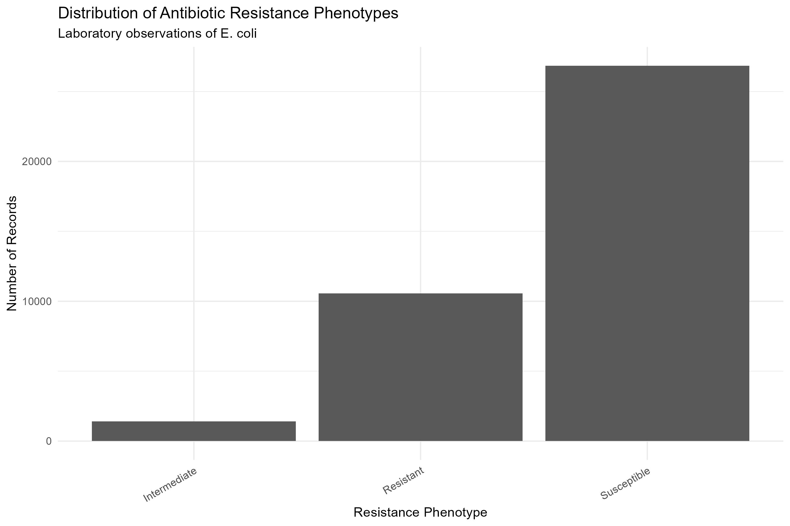
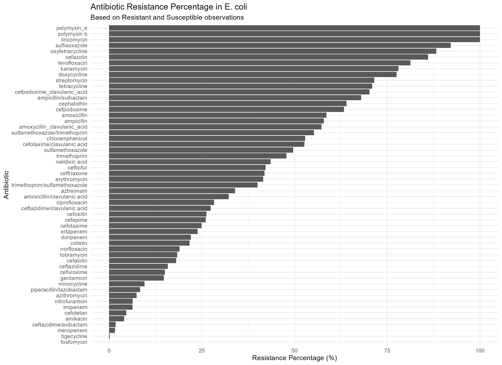
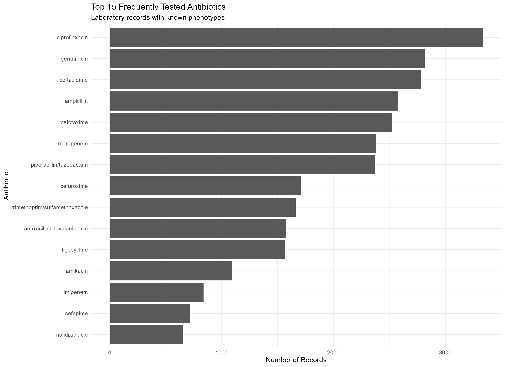
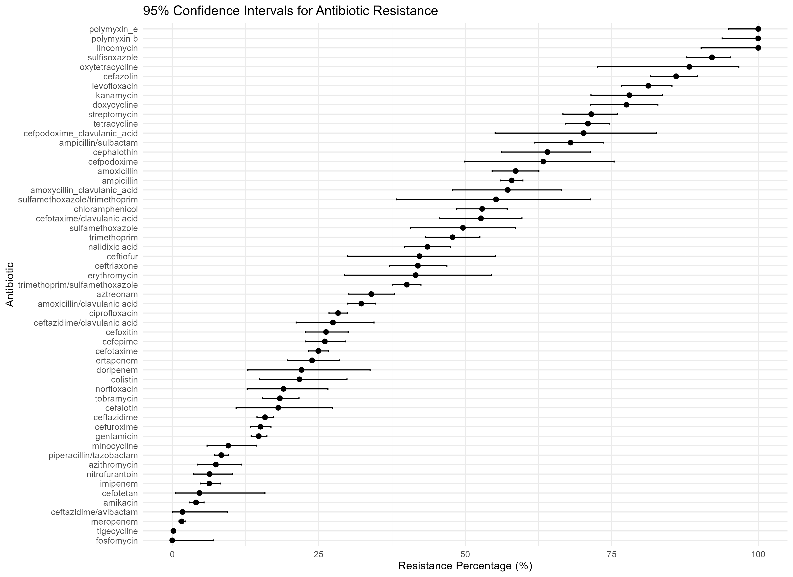
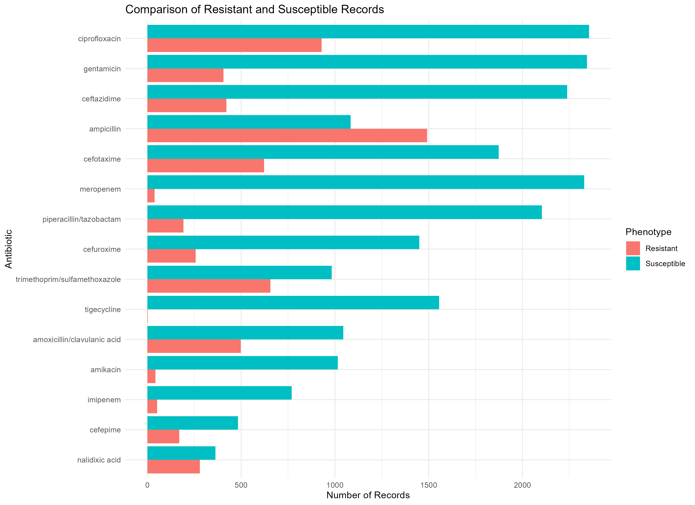

# Statistical Analysis of Multidrug Resistance Patterns in Escherichia coli

**Registration Number:** 2021/ASP/35  
**Programming Language:** R  
**Development Environment:** RStudio  
**Dataset:** BVBRC Genome Antimicrobial Resistance Dataset  
**Research Area:** Bioinformatics, Antimicrobial Resistance, Statistical Data Analysis

---

## 1. Project Abstract

Antimicrobial Resistance (AMR) is a major global public health concern because bacteria can become resistant to antibiotics, making bacterial infections more difficult to treat.

This project investigates antibiotic resistance patterns in *Escherichia coli* (E. coli) using statistical analysis and data visualization in R programming.

A bacterial antimicrobial resistance dataset from BVBRC was used for this study. The dataset contains bacterial genome identifiers, antibiotic information, resistance phenotypes, and different types of supporting evidence.

The project involves data importing, data cleaning, exploratory data analysis, statistical testing, and visualization.

The dataset was filtered to select E. coli records using Taxon ID 562. Laboratory-based records with known resistance phenotypes were selected for the main statistical analysis.

Antibiotic-specific resistance percentages were calculated, and 95% confidence intervals were estimated using exact binomial methods. A Chi-square test was implemented to investigate associations between antibiotic type and resistance phenotype, while Cramer's V was calculated to describe the strength of association.

The visualizations demonstrate differences in antibiotic testing frequencies, resistance percentages, and the distribution of resistant and susceptible observations.

The project demonstrates how statistical programming can support the investigation of antimicrobial resistance patterns in bacterial datasets.

**Keywords:** Antimicrobial Resistance, Escherichia coli, Bioinformatics, R Programming, Statistical Analysis, Antibiotic Resistance, Chi-square Test, Confidence Intervals.

---

## 2. Introduction

### 2.1 What is Antimicrobial Resistance?

Antimicrobial Resistance (AMR) occurs when microorganisms develop the ability to survive or grow despite exposure to antimicrobial medicines that would normally inhibit or kill them.

Antibiotic resistance specifically refers to resistance against medicines used to treat bacterial infections.

Antibiotic resistance is important because it can:

- Make bacterial infections more difficult to treat.
- Reduce the effectiveness of available antibiotics.
- Increase healthcare costs.
- Increase the risk of severe illness.
- Create challenges for infection prevention and control.

### 2.2 What is Escherichia coli?

*Escherichia coli* (E. coli) is a bacterial species commonly found in the intestines of humans and animals.

Although many E. coli strains are harmless, some can cause urinary tract infections, gastrointestinal infections, bloodstream infections, and other diseases.

Some E. coli strains develop resistance to antibiotics, creating challenges for treatment.

### 2.3 Research Problem

Different antibiotics may show different resistance patterns in E. coli.

Understanding these patterns requires systematic data analysis, statistical methods, and visualization.

This project examines the distribution of antibiotic resistance phenotypes and investigates how resistance proportions vary across different antibiotics.

---

## 3. Project Objectives

### Main Objective

To investigate antibiotic resistance patterns in E. coli using statistical analysis and visualization in R programming.

### Specific Objectives

1. Import and inspect a bacterial antimicrobial resistance dataset.
2. Identify missing values, duplicate records, and data-quality issues.
3. Clean and preprocess the dataset.
4. Select E. coli records using Taxon ID 562.
5. Separate laboratory evidence from computational evidence.
6. Analyze resistant, susceptible, and intermediate phenotypes.
7. Identify frequently tested antibiotics.
8. Calculate antibiotic-specific resistance percentages.
9. Estimate 95% confidence intervals.
10. Investigate associations between antibiotic type and resistance phenotype using a Chi-square test.
11. Measure association strength using Cramer's V.
12. Visualize and interpret antibiotic resistance patterns.

---

## 4. Dataset Description

### 4.1 Dataset Source

The project uses the BVBRC genome antimicrobial resistance dataset.

**Input file:**

`data/raw/BVBRC_genome_amr.csv`

### 4.2 Dataset Information

The earlier initial data audit identified:

| Description | Value |
|---|---:|
| Original records | 195,795 |
| Columns | 21 |
| E. coli records before final cleaning | 194,927 |
| E. coli records with known phenotype before laboratory-only selection | 94,998 |

These values describe the earlier data audit. Final counts after exact duplicate removal and laboratory filtering should be taken from the generated results.

### 4.3 Important Dataset Variables

| Variable | Description |
|---|---|
| Genome ID | Identifier of a bacterial genome |
| Taxon ID | Taxonomic identifier of the organism |
| Antibiotic | Antibiotic associated with the record |
| Resistant Phenotype | Susceptibility or resistance classification |
| Evidence | Source of the resistance evidence |
| Measurement | Recorded laboratory measurement |
| Laboratory Typing Method | Method used for laboratory testing |
| Testing Standard | Standard used to interpret results |
| Testing Standard Year | Year of the testing standard |
| PubMed | Publication reference when available |

### 4.4 Resistance Phenotype Categories

**Resistant:** The bacterium is classified as resistant to the antibiotic under the applicable testing criteria.

**Susceptible:** The bacterium is classified as susceptible to the antibiotic.

**Intermediate:** A category between susceptible and resistant, depending on the testing standard.

Other categories may include Nonsusceptible and Susceptible-dose dependent.

---

## 5. Project Methodology

The project follows five major stages.

### Stage 1: Data Import

**Script:** `01_data_import.R`

The dataset is imported into RStudio using the `readr` and `data.table` packages.

The following checks are performed:

- Dataset file availability.
- Dataset dimensions.
- Column names and data types.
- Missing genome identifiers.
- Missing evidence values.
- Duplicate records.
- Repeated genome–antibiotic combinations.

The `fread()` function is used for efficient reading of the full CSV dataset.

### Stage 2: Data Cleaning and Preprocessing

**Script:** `02_data_cleaning.R`

The cleaning process includes:

1. Creating a copy of the original dataset.
2. Removing unnecessary spaces from character fields.
3. Converting empty strings into missing values.
4. Identifying and removing exact duplicate rows.
5. Standardizing antibiotic names to lowercase.
6. Filtering E. coli records using Taxon ID 562.
7. Separating laboratory and computational records.
8. Selecting laboratory records with known resistance phenotypes.

The cleaned datasets are saved in RDS format for further analysis.

### Stage 3: Exploratory Data Analysis

**Script:** `03_exploratory_analysis.R`

Exploratory Data Analysis (EDA) is used to understand the dataset before performing statistical tests.

The analysis includes:

- Basic dataset summaries.
- Distribution of evidence types.
- Distribution of resistance phenotypes.
- Laboratory phenotype counts.
- Frequently tested antibiotics.
- Missing-value analysis.

Three exploratory graphs are generated.

### Stage 4: Statistical Analysis

**Script:** `04_statistical_analysis.R`

Statistical analysis is performed using laboratory observations with known phenotypes and antibiotic names.

The methods include:

**Descriptive statistics:** Counting and calculating percentages for different resistance phenotypes.

**Resistance percentage:** Calculating the proportion of Resistant observations among Resistant and Susceptible observations.

**95% confidence intervals:** Estimating uncertainty using the exact binomial method.

**Chi-square test:** Investigating whether resistance phenotype distributions are associated with antibiotic identity.

**Cramer's V:** Measuring the strength of the association between categorical variables.

### Stage 5: Data Visualization

**Script:** `05_visualization.R`

The final stage generates five statistical visualizations.

The graphs show:

- Laboratory resistance phenotype distribution.
- Antibiotic resistance percentages.
- Top 15 frequently tested antibiotics.
- 95% confidence intervals.
- Resistant versus Susceptible record comparisons.

---

## 6. Statistical Methods

### 6.1 Descriptive Statistics

Descriptive statistics summarize the number and percentage of observations in each resistance category.

These summaries help identify the most common phenotypes and compare antibiotics.

### 6.2 Antibiotic Resistance Percentage

The resistance percentage is calculated as:

**Resistance Percentage = Resistant / (Resistant + Susceptible) × 100**

Only Resistant and Susceptible observations are used in this calculation.

Intermediate and Nonsusceptible observations are not included in the denominator.

### 6.3 Confidence Intervals

The project calculates exact binomial 95% confidence intervals using the R function `binom.test()`.

A confidence interval describes the uncertainty around an estimated resistance percentage.

A wider interval generally indicates greater uncertainty.

### 6.4 Chi-square Test

The Chi-square test investigates whether the distribution of resistance phenotypes differs across selected antibiotics.

**Null hypothesis (H0):** Antibiotic type and resistance phenotype are independent.

**Alternative hypothesis (H1):** Antibiotic type and resistance phenotype are associated.

The project uses a simulated p-value with 10,000 replicates.

The actual p-value and Chi-square statistic are saved in:

`results/chi_square_results.csv`

### 6.5 Cramer's V

Cramer's V is used to measure the strength of association between antibiotic type and resistance phenotype.

Its value ranges from 0 to 1.

A value closer to 0 suggests a weaker association, while a value closer to 1 suggests a stronger association.

The calculated result is saved in `chi_square_results.csv`.

---

## 7. Results and Visualizations

This section presents the eight graphs generated during exploratory and statistical analysis.

### 7.1 Distribution of Evidence Types



**Description**

This graph compares records classified under Computational Method, Laboratory Method, and missing evidence categories.

**Observations**

- Computational Method records represent the largest category.
- Laboratory Method records represent a much smaller proportion.
- Records with missing evidence are comparatively few.

**Interpretation**

The dataset contains a large amount of computational evidence. However, computational predictions and laboratory observations are different types of evidence.

Therefore, the project uses laboratory observations for its main statistical analysis.

**Key finding:** Computational evidence dominates the broader dataset, while laboratory records provide the basis for the resistance analysis.

### 7.2 Distribution of Antibiotic Resistance Phenotypes



**Description**

This graph displays the number of laboratory records classified as Intermediate, Resistant, or Susceptible.

**Observations**

- Susceptible is the largest category.
- Resistant is the second-largest category.
- Intermediate represents a smaller group.

**Interpretation**

The majority of laboratory observations in this dataset are classified as susceptible.

However, resistant observations remain substantial, indicating that resistance is present among the tested records.

**Key finding:** Susceptible records outnumber Resistant records in the analyzed laboratory data.

### 7.3 Top 15 Frequently Tested Antibiotics — Exploratory Analysis



**Description**

This horizontal bar chart presents the 15 antibiotics with the highest number of laboratory records.

**Observations**

The most frequently tested antibiotics include:

1. Ciprofloxacin
2. Gentamicin
3. Ceftazidime
4. Ampicillin
5. Cefotaxime

Other frequently tested antibiotics include meropenem, piperacillin/tazobactam, cefuroxime, and trimethoprim/sulfamethoxazole.

**Interpretation**

Ciprofloxacin has the highest number of recorded laboratory observations in the chart.

This does not mean ciprofloxacin has the highest resistance percentage. It only indicates that it appears most frequently in the selected laboratory records.

**Key finding:** Antibiotic testing frequencies vary considerably across the dataset.

### 7.4 Laboratory Resistance Phenotype Distribution



**Description**

This graph presents the distribution of resistance phenotypes in the laboratory observations used for statistical analysis.

**Observations**

- Susceptible records form the largest group.
- Resistant records form the second-largest group.
- Intermediate records are less frequent.

**Interpretation**

The distribution indicates that susceptibility is more frequently recorded than resistance in the analyzed laboratory dataset.

The graph provides an overview of the response categories before comparing individual antibiotics.

**Key finding:** The laboratory phenotype distribution is dominated by susceptible observations.

### 7.5 Antibiotic Resistance Percentage in E. coli



**Description**

This graph compares antibiotic resistance percentages across different antibiotics.

The percentages are calculated using Resistant and Susceptible observations.

The visualization includes antibiotics with at least 30 Resistant or Susceptible records.

**Observations**

- Polymyxin E, polymyxin B, and lincomycin appear at approximately 100% observed resistance.
- Sulfisoxazole and oxytetracycline also show high observed resistance percentages.
- Ampicillin and amoxicillin show substantial observed resistance.
- Meropenem, tigecycline, and fosfomycin appear near the lower end of the chart.

**Interpretation**

Resistance percentages vary considerably across antibiotics.

However, a high resistance percentage must be interpreted together with the number of observations and the confidence interval.

These percentages describe the available dataset and should not be interpreted as general population resistance rates or clinical treatment recommendations.

**Key finding:** Antibiotic-specific resistance levels differ substantially in the analyzed records.

### 7.6 Top 15 Frequently Tested Antibiotics — Statistical Analysis



**Description**

This graph displays the most frequently tested antibiotics selected during statistical analysis.

**Observations**

- Ciprofloxacin has the highest number of records.
- Gentamicin and ceftazidime follow.
- Ampicillin and cefotaxime also have large numbers of observations.
- Antibiotics such as cefepime and nalidixic acid have fewer observations among the selected 15.

**Interpretation**

The graph demonstrates that the dataset contains unequal numbers of laboratory observations across antibiotics.

This is important because antibiotics with more records may produce more precise resistance estimates than antibiotics with fewer records.

**Key finding:** Sample sizes vary across antibiotics and should be considered when interpreting statistical results.

### 7.7 95% Confidence Intervals for Antibiotic Resistance



**Description**

This graph presents antibiotic resistance estimates together with their 95% confidence intervals.

Each point represents an estimated resistance percentage, while the horizontal line represents its confidence interval.

**Observations**

- Resistance estimates differ considerably across antibiotics.
- Some antibiotics have relatively narrow confidence intervals.
- Others have wider confidence intervals.
- Antibiotics with very high observed resistance still have uncertainty around their estimated resistance proportions.

**Interpretation**

Confidence intervals help evaluate the precision of estimated resistance percentages.

A wider interval indicates greater uncertainty.

The exact confidence interval values are stored in:

`results/resistance_confidence_intervals.csv`

**Key finding:** Resistance estimates should be interpreted alongside their statistical uncertainty rather than using percentages alone.

### 7.8 Comparison of Resistant and Susceptible Records



**Description**

This grouped horizontal bar chart compares the number of Resistant and Susceptible observations for frequently tested antibiotics.

**Observations**

- Ciprofloxacin has more Susceptible than Resistant observations.
- Gentamicin and ceftazidime show substantially more Susceptible records.
- Ampicillin has a large Resistant group, exceeding its Susceptible group in the displayed chart.
- Meropenem shows many more Susceptible than Resistant observations.
- Tigecycline and amikacin also show relatively small Resistant groups.

**Interpretation**

The graph highlights differences in resistance and susceptibility counts across antibiotics.

However, absolute counts depend on the number of tests available for each antibiotic.

Resistance percentages are more appropriate for comparing proportions.

**Key finding:** The balance between Resistant and Susceptible observations differs across antibiotics.

---

## 8. Discussion of Results

The analysis identifies several important patterns.

### 8.1 Evidence Distribution

Computational records are much more common than laboratory records in the broader dataset.

This supports the decision to distinguish evidence types during analysis.

### 8.2 Overall Phenotype Distribution

Susceptible records are more common than Resistant records in the selected laboratory data.

However, resistance remains an important feature of the dataset.

### 8.3 Differences Between Antibiotics

Resistance percentages differ considerably across antibiotics.

Some antibiotics have high observed resistance percentages, while others have relatively low percentages.

### 8.4 Testing Frequency

Ciprofloxacin, gentamicin, and ceftazidime have large numbers of laboratory observations.

Different sample sizes may affect the precision of resistance estimates.

### 8.5 Statistical Uncertainty

Confidence intervals demonstrate that estimated resistance percentages have different levels of uncertainty.

This is particularly important when interpreting antibiotics with relatively small sample sizes.

### 8.6 Statistical Association

The project implements a Chi-square test to investigate the relationship between antibiotic type and resistance phenotype.

Cramer's V is calculated to describe the strength of the association.

The numerical test results should be interpreted using the generated `chi_square_results.csv` file.

---

## 9. Project Directory Structure

```text
2021-ASP-35/
|
|-- README.md
|-- 2021-ASP-35.Rproj
|
|-- code/
|   |-- 01_data_import.R
|   |-- 02_data_cleaning.R
|   |-- 03_exploratory_analysis.R
|   |-- 04_statistical_analysis.R
|   |-- 05_visualization.R
|
|-- data/
|   |-- raw/
|   |   |-- BVBRC_genome_amr.csv
|   |
|   |-- processed/
|       |-- amr_clean.rds
|       |-- ecoli_lab_clean.rds
|       |-- ecoli_computational.rds
|
|-- results/
|   |-- basic_summary.csv
|   |-- evidence_summary.csv
|   |-- phenotype_summary.csv
|   |-- lab_phenotype_summary.csv
|   |-- antibiotic_summary.csv
|   |-- missing_summary.csv
|   |-- statistical_phenotype_counts.csv
|   |-- antibiotic_statistical_summary.csv
|   |-- resistance_confidence_intervals.csv
|   |-- top_antibiotics_statistical.csv
|   |-- chi_square_results.csv
|
|-- figures/
    |-- evidence_distribution.png
    |-- phenotype_distribution.png
    |-- top_15_antibiotics.png
    |-- 01_phenotype_distribution.png
    |-- 02_resistance_percentage.png
    |-- 03_top_antibiotics.png
    |-- 04_resistance_confidence_intervals.png
    |-- 05_resistant_vs_susceptible.png
```

---

## 10. Tools and Technologies

| Tool | Purpose |
|---|---|
| R | Statistical programming and data analysis |
| RStudio | Development environment |
| readr | CSV data importing |
| data.table | Efficient data processing and manipulation |
| ggplot2 | Data visualization |
| GitHub | Project documentation and version control |
| CSV | Dataset and statistical output storage |
| RDS | Storage of processed R objects |

---

## 11. How to Run the Project

### Step 1: Install R and RStudio

Install R and RStudio on your computer.

### Step 2: Open the Project

Open `2021-ASP-35.Rproj` in RStudio.

### Step 3: Install Required Packages

Run the following command in the RStudio Console:

```r
install.packages(c("readr", "data.table", "ggplot2"))
```

### Step 4: Prepare the Dataset

Place the original CSV file in:

`data/raw/BVBRC_genome_amr.csv`

### Step 5: Create Output Folders

```r
dir.create("data/processed", recursive = TRUE, showWarnings = FALSE)
dir.create("results", recursive = TRUE, showWarnings = FALSE)
dir.create("figures", recursive = TRUE, showWarnings = FALSE)
```

### Step 6: Run the Scripts in Order

```r
source("code/01_data_import.R")
source("code/02_data_cleaning.R")
source("code/03_exploratory_analysis.R")
source("code/04_statistical_analysis.R")
source("code/05_visualization.R")
```

### Step 7: Check the Outputs

After successful execution:

- Cleaned data files are saved in `data/processed/`.
- Summary and statistical CSV files are saved in `results/`.
- Generated graphs are saved in `figures/`.

---

## 12. Project Output Files

| Output File | Description |
|---|---|
| basic_summary.csv | Basic dataset information |
| evidence_summary.csv | Evidence-type distribution |
| phenotype_summary.csv | Overall resistance phenotype counts |
| lab_phenotype_summary.csv | Laboratory phenotype distribution |
| antibiotic_summary.csv | Antibiotic testing frequencies |
| missing_summary.csv | Missing-value analysis |
| statistical_phenotype_counts.csv | Phenotype counts and percentages |
| antibiotic_statistical_summary.csv | Antibiotic resistance statistics |
| resistance_confidence_intervals.csv | Resistance percentages and 95% confidence intervals |
| top_antibiotics_statistical.csv | Frequently tested antibiotics used in statistical comparison |
| chi_square_results.csv | Chi-square statistic, p-value, Cramer's V, and simulation count |

---

## 13. Limitations

The study has several limitations.

1. **Missing data:** Some records contain missing values, which may affect analysis.
2. **Duplicate records:** Exact duplicates are removed, but repeated measurements may still exist.
3. **Unequal sample sizes:** Some antibiotics have more observations than others.
4. **Evidence differences:** Computational evidence and laboratory evidence are not equivalent.
5. **Dataset representativeness:** The available records may not represent all E. coli populations.
6. **Statistical assumptions:** Repeated observations may affect assumptions of independence.
7. **Clinical interpretation:** The findings cannot independently determine the best antibiotic for treating an individual patient.
8. **Multidrug resistance classification:** The scripts analyze antibiotic-specific resistance but do not implement a formal genome-level MDR classification.
9. **Prediction:** No machine-learning prediction model is trained in the supplied scripts.

---

## 14. Future Improvements

Future development could include:

- Investigating antibiotic resistance across additional bacterial species.
- Studying genome-level multidrug resistance using antibiotic classes.
- Comparing computational predictions with laboratory results.
- Incorporating bacterial genomic features into predictive models.
- Validating results using independent datasets.
- Developing interactive visualizations.
- Performing additional statistical analyses to account for repeated measurements.

---

## 15. Conclusion

This project demonstrates the application of R programming to the statistical analysis of antibiotic resistance patterns in E. coli.

The study includes data importing, preprocessing, exploratory analysis, statistical testing, and visualization.

The laboratory phenotype distribution indicates that susceptible observations are more frequent than resistant observations in the analyzed data.

Ciprofloxacin is the most frequently tested antibiotic in the supplied visualizations.

Antibiotic resistance percentages vary considerably across different antibiotics.

The use of 95% confidence intervals helps describe uncertainty, while Chi-square testing and Cramer's V provide methods for investigating associations between antibiotic identity and resistance phenotype.

Overall, the project demonstrates how statistical methods and data visualization can support the exploration and understanding of antimicrobial resistance data in bioinformatics.

---

## 16. Viva Presentation Summary

**Project Title:** Statistical Analysis of Multidrug Resistance Patterns in Escherichia coli

**Project Aim:** To analyze antibiotic resistance patterns in E. coli using R programming.

**Dataset:** BVBRC genome antimicrobial resistance dataset.

**Software:** RStudio.

**Main Steps:** Data importing, cleaning, exploratory analysis, statistical analysis, and visualization.

**Statistical Methods:** Resistance percentages, 95% confidence intervals, Chi-square test, and Cramer's V.

**Main Finding:** Susceptible laboratory observations are more frequent overall, but resistance patterns differ across antibiotics.

**Project Importance:** The project demonstrates how statistical analysis can help investigate antibiotic resistance patterns in bacterial data.

---

## 17. References and Resources

- Bacterial and Viral Bioinformatics Resource Center (BVBRC): https://www.bv-brc.org/
- R Project for Statistical Computing: https://www.r-project.org/
- RStudio: https://posit.co/products/open-source/rstudio/
- ggplot2 documentation: https://ggplot2.tidyverse.org/
- data.table documentation: https://rdatatable.gitlab.io/data.table/

---

**Project:** Statistical Analysis of Multidrug Resistance Patterns in Escherichia coli  
**Registration Number:** 2021/ASP/35  
**Research Area:** Bioinformatics and Antimicrobial Resistance
